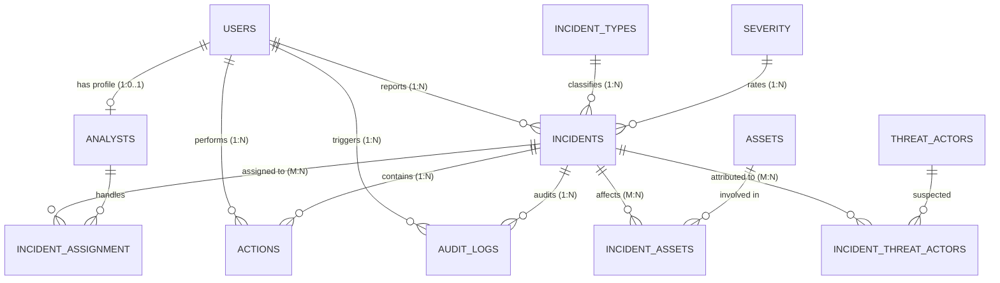
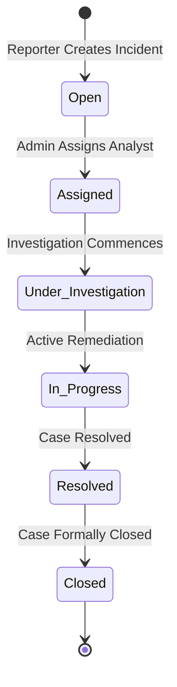

# CIMS: Comprehensive Database Management System (DBMS) Analysis

**Project Title**: Cybersecurity Incident Management System (CIMS)  
**Academic Level**: 5th Semester B.Tech / B.E. Computer Science & Engineering (DBMS Project Evaluation)  
**Authors**: CIMS Engineering Team  
**Technologies**: PostgreSQL 16 (Authoritative Relational Store), MongoDB 8.0 (Security Telemetry Document Store), FastAPI (Python 3.14 REST API), React 18 / Vite 6 (SOC Operational Console)

---

## Executive Summary

The Cybersecurity Incident Management System (CIMS) is an enterprise-grade academic implementation of an incident-response platform designed to illustrate modern relational database principles, polyglot persistence, cryptographic audit chaining, and role-based access control (RBAC). 

This document provides a comprehensive technical and theoretical analysis across three essential academic dimensions:
1. **Database Normalization (1NF, 2NF, and 3NF)**: Analysis of the 12 relational tables, functional dependencies, junction entities, and anomaly mitigation.
2. **Security and Validation Demonstration**: In-depth inspection of password hashing (Argon2id), JWT authentication, transaction locks, lifecycle state machines, and Pydantic/database constraints.
3. **Partial Output & Verification**: End-to-end trace of 7 core operations proving the runtime cohesion between the React frontend, FastAPI application layer, PostgreSQL, and MongoDB.
4. **DBMS Viva Voce Preparation**: Frequently asked technical questions and authoritative answers for viva examinations.

---

# Section 1: Database Normalization

Database normalization is the formal process of structuring a relational database schema to minimize data redundancy and prevent insertion, update, and deletion anomalies while enforcing referential integrity. In CIMS, the relational schema in PostgreSQL is structured to strictly adhere to **Third Normal Form (3NF)**.

### Overview of Relational Architecture

CIMS separates concerns between authoritative relational workflow data and semi-structured security telemetry:
- **PostgreSQL 16**: Manages structured, transactional operational entities (users, analyst profiles, incidents, classifications, assignments, actions, threat actors, and tamper-evident audit logs).
- **MongoDB 8.0**: Manages high-velocity, polymorphic event telemetry documents (`security_logs`) where schemas vary across network sensors, firewall logs, and intrusion detection alerts.



---

## 1.1 Relational Schema Table Catalog

The PostgreSQL relational schema contains exactly **12 tables**:

| # | Table Name | Primary Key | Foreign Keys | Columns | Business Purpose |
|---|---|---|---|---|---|
| 1 | `users` | `user_id` | *None* | `user_id`, `name`, `email`, `password_hash`, `role`, `department`, `created_at` | Stores authenticated identities across `ADMIN`, `ANALYST`, and `REPORTER` roles. |
| 2 | `analysts` | `user_id` | `user_id → users.user_id` | `user_id`, `expertise`, `workload` | 1:1 extension storing specialized analyst profile skills and active case load. |
| 3 | `incident_types` | `type_id` | *None* | `type_id`, `name`, `description` | Standardized incident categories (e.g., Malware, Phishing, Denial of Service). |
| 4 | `severity` | `severity_id` | *None* | `severity_id`, `level`, `response_sla_hours`, `resolution_sla_hours` | Predefined severity tiers (`Low`, `Medium`, `High`, `Critical`) with SLA targets. |
| 5 | `incidents` | `incident_id` | `type_id → incident_types.type_id`<br>`severity_id → severity.severity_id`<br>`reported_by → users.user_id` | `incident_id`, `title`, `description`, `type_id`, `severity_id`, `reported_by`, `status`, `reported_date`, `resolved_date` | Authoritative operational case records and lifecycle state machine. |
| 6 | `assets` | `asset_id` | *None* | `asset_id`, `name`, `type`, `ip_address`, `department` | Inventory of organizational infrastructure, endpoints, and servers. |
| 7 | `incident_assets` | (`incident_id`, `asset_id`) | `incident_id → incidents.incident_id`<br>`asset_id → assets.asset_id` | `incident_id`, `asset_id`, `impact_type` | Many-to-Many junction linking affected assets to cases with contextual impact details. |
| 8 | `incident_assignment` | `assignment_id` | `incident_id → incidents.incident_id`<br>`analyst_id → analysts.user_id` | `assignment_id`, `incident_id`, `analyst_id`, `assigned_date`, `role` | Assignment history and analyst role delegation per incident. |
| 9 | `actions` | `action_id` | `incident_id → incidents.incident_id`<br>`performed_by → users.user_id` | `action_id`, `incident_id`, `performed_by`, `description`, `action_date` | Chronological investigation steps and remediation notes. |
| 10 | `threat_actors` | `actor_id` | *None* | `actor_id`, `alias`, `description` | Intelligence profiles tracking known adversaries and APT groups. |
| 11 | `incident_threat_actors` | (`incident_id`, `actor_id`) | `incident_id → incidents.incident_id`<br>`actor_id → threat_actors.actor_id` | `incident_id`, `actor_id` | Many-to-Many junction attributing incidents to adversary profiles. |
| 12 | `audit_logs` | `log_id` | `incident_id → incidents.incident_id`<br>`performed_by → users.user_id` | `log_id`, `incident_id`, `performed_by`, `action_type`, `action_data`, `hash`, `prev_hash`, `timestamp` | Tamper-evident, cryptographically chained record of all system state changes. |

---

## 1.2 First Normal Form (1NF)

### Academic Definition
A relation is in **First Normal Form (1NF)** if and only if:
1. Every attribute value is **atomic** (indivisible).
2. There are **no repeating groups** or multivalued arrays stored within a single tuple.
3. Each record is uniquely identifiable by a Primary Key.

### Application to CIMS
In unnormalized database designs, an incident record often stores lists of involved assets, assigned analysts, or IP addresses as comma-separated text strings (e.g., `affected_assets: "Server-01, DB-Primary, Gateway-East"` or `assigned_analysts: "Alice, Bob"`). 

This anti-pattern introduces severe anomalies:
- Inability to search or index individual assets using B-Tree indexes.
- Inability to enforce foreign key integrity against an asset catalog.
- Complex string manipulation functions required for simple queries.

**How CIMS Satisfies 1NF**:
- **Atomic Attributes**: In `incidents`, every column (`incident_id`, `title`, `description`, `status`) holds exactly one scalar value.
- **Elimination of Repeating Groups**:
  - Instead of storing multiple assets inside `incidents`, each asset relationship is moved into a dedicated junction table row in `incident_assets`.
  - Instead of storing multiple analyst assignments as a delimited string, each assignment is stored as an individual row in `incident_assignment`.
  - Chronological activity steps are represented as individual rows in `actions`.
- **IP Address Atomicity**: In `assets`, `ip_address` is constrained to a single IPv4/IPv6 string (up to 45 characters) and indexed uniquely.

---

## 1.3 Second Normal Form (2NF)

### Academic Definition
A relation is in **Second Normal Form (2NF)** if and only if:
1. It is in First Normal Form (1NF).
2. It has **no partial functional dependencies**, meaning every non-prime attribute is fully functionally dependent on the **entire** candidate key (not a proper subset of it).

*Note*: Partial functional dependencies can only exist in tables with a **composite candidate key**. If a table has a single-column primary key, it automatically satisfies 2NF.

### Application to CIMS: Analysis of Junction Tables

In CIMS, 10 of the 12 tables use single-attribute integer primary keys (`user_id`, `type_id`, `severity_id`, `incident_id`, `asset_id`, `assignment_id`, `action_id`, `actor_id`, `log_id`), which are inherently in 2NF.

The remaining two tables use composite primary keys:

#### 1. `incident_assets` Table
- **Composite Primary Key**: `(incident_id, asset_id)`
- **Non-Prime Attribute**: `impact_type` (VARCHAR 120)
- **Functional Dependency**:
  $$\{ \text{incident\_id}, \text{asset\_id} \} \to \text{impact\_type}$$
- **Verification**: `impact_type` (e.g., `"Compromised Database"`, `"Exfiltrated Source"`, `"Target of Denial of Service"`) describes the *specific relationship* between that precise asset during that precise incident. It does **not** depend solely on `asset_id` (a server is not permanently compromised across all incidents) nor does it depend solely on `incident_id` (an incident involves multiple assets experiencing different impact types). Because `impact_type` depends on the **entire composite key**, there is no partial dependency. The table satisfies 2NF.

#### 2. `incident_threat_actors` Table
- **Composite Primary Key**: `(incident_id, actor_id)`
- **Non-Prime Attributes**: *None*
- **Verification**: Because all attributes are part of the primary key, no partial dependencies can mathematically exist. The table strictly satisfies 2NF.

#### 3. `incident_assignment` Table
- Rather than a composite primary key, `incident_assignment` uses a surrogate primary key `assignment_id` with a database-enforced unique constraint on `(incident_id, analyst_id)`.
- Non-prime attributes: `assigned_date`, `role` (e.g., `"Primary Analyst"`).
- Both `assigned_date` and `role` depend fully on the assignment record.

---

## 1.4 Third Normal Form (3NF)

### Academic Definition
A relation is in **Third Normal Form (3NF)** if and only if:
1. It is in Second Normal Form (2NF).
2. There are **no transitive functional dependencies**, meaning no non-prime attribute is functionally dependent on another non-prime attribute ($X \to Y$ and $Y \to Z$, where $X$ is a superkey, $Y$ is not a superkey, and $Z$ is a non-prime attribute).

In simple words: **Every non-key attribute must provide a fact about the key, the whole key, and nothing but the key.**

### Application to CIMS: Elimination of Transitive Dependencies

In an unnormalized incident table, one might store:
```text
INCIDENTS_UNNORMALIZED(incident_id, title, type_name, type_description, 
                       severity_level, response_sla, resolution_sla, reporter_name)
```
In this unnormalized relation, the functional dependencies are:
1. $\text{incident\_id} \to \text{type\_name}$
2. $\text{type\_name} \to \text{type\_description}$  *(Transitive Dependency: $\text{incident\_id} \to \text{type\_description}$)*
3. $\text{incident\_id} \to \text{severity\_level}$
4. $\text{severity\_level} \to (\text{response\_sla}, \text{resolution\_sla})$  *(Transitive Dependency)*

### How CIMS Achieves 3NF

CIMS decomposes these transitive relationships into distinct, referenced lookup entities:

#### 1. Separation of Incident Types (`incident_types`)
- **Decomposition**: Stored in `incident_types(type_id, name, description)`.
- **Foreign Key**: `incidents.type_id` references `incident_types.type_id` with `ON DELETE RESTRICT`.
- **Anomaly Prevention**: If the description of "Phishing" changes, it is updated in exactly **one place** in `incident_types`. No update anomalies occur across thousands of historical incidents. If all phishing incidents are deleted, the definition of phishing is preserved (preventing deletion anomalies).

#### 2. Separation of Severity & SLAs (`severity`)
- **Decomposition**: Stored in `severity(severity_id, level, response_sla_hours, resolution_sla_hours)`.
- **Foreign Key**: `incidents.severity_id` references `severity.severity_id` with `ON DELETE RESTRICT`.
- **Anomaly Prevention**: SLA limits are defined uniformly. An administrator cannot accidentally set a Critical response SLA to 4 hours on one incident and 12 hours on another.

#### 3. Separation of User Identity and Analyst Workload (`users` vs. `analysts`)
- **Decomposition**:
  - `users(user_id, name, email, password_hash, role, department, created_at)`
  - `analysts(user_id, expertise, workload)`
- **Foreign Key**: `analysts.user_id` references `users.user_id` with `ON DELETE CASCADE`.
- **Anomaly Prevention**: Operational fields such as SOC `workload` and `expertise` belong solely to security analysts, not general reporters or administrators. Separating this 1:1 relationship prevents nullable columns and ensures user identity is independent of SOC operational status.

---

## 1.5 Database Relationships Summary

```text
[users] 1 ------- 0..1 [analysts]              (1:1 Subtype Extension)
[users] 1 ------- N    [incidents]             (1:N Reporting)
[users] 1 ------- N    [actions]               (1:N Investigation Execution)
[users] 1 ------- N    [audit_logs]            (1:N Operation Actor)

[incident_types] 1 --- N [incidents]          (1:N Classification)
[severity] 1 --------- N [incidents]          (1:N Policy Rating)

[incidents] 1 -------- N [actions]             (1:N Action Timeline)
[incidents] 1 -------- N [audit_logs]          (1:N Tamper-Evident History)

[incidents] M -------- N [assets]              (M:N via incident_assets)
[incidents] M -------- N [analysts]            (M:N via incident_assignment)
[incidents] M -------- N [threat_actors]       (M:N via incident_threat_actors)
```

---

## 1.6 Architectural Roles: PostgreSQL vs. MongoDB

CIMS adopts a **Polyglot Persistence** architecture, combining the complementary strengths of relational and document stores:

| Dimension | PostgreSQL 16 (Relational Engine) | MongoDB 8.0 (Document Store) |
|---|---|---|
| **Primary Domain** | Relational core business entities, workflow states, referential integrity. | Raw security telemetry, firewall packet captures, SIEM alert dumps. |
| **Data Model** | 12 Normalized relational tables, ACID transactions. | JSON-like BSON documents (`security_logs` collection). |
| **Schema Policy** | Strict, compile-time schema with CHECK and FOREIGN KEY constraints. | Flexible schema supporting arbitrary nested `metadata` objects. |
| **Integrity Enforcement** | Database-level referential integrity and transactional rollback. | Application-level validation coordinated via FastAPI middleware. |
| **Audit Requirement** | Authoritative SHA-256 cryptographic chain stored in `audit_logs`. | Queryable telemetry linked to `incident_id`. |

### Cross-Database Linking Mechanism
MongoDB stores a scalar field `incident_id: <int>` on each log document. Because a cross-database foreign key cannot be enforced by the storage engines, the FastAPI backend acts as the authoritative coordination layer:
```python
# backend/app/routers/security_logs.py
incident = load_incident_for_update(db, payload.incident_id)
if incident is None:
    raise HTTPException(status_code=404, detail="Incident not found.")
require_assigned_analyst_or_admin(db, incident, current_user)
require_active_incident(incident)
return insert_security_log(collection, payload)
```
If an incident does not exist in PostgreSQL, the API rejects the MongoDB insert with HTTP 404, preserving data consistency.

---

## 1.7 Summary of Normalization Advantages

1. **Elimination of Insertion Anomalies**: New incident types or severity tiers can be defined prior to any incident being reported.
2. **Elimination of Update Anomalies**: Updating an asset IP address or analyst name requires updating exactly one row in one table; all linked incident views immediately reflect the change.
3. **Elimination of Deletion Anomalies**: Resolving or removing an incident does not delete the master record of an asset or threat actor.
4. **Optimized Storage**: Text descriptions of severity levels and incident types are stored once, rather than repeated across millions of rows.
5. **Explicit SQL Querying**: Facilitates efficient multi-table relational `JOIN` queries and aggregations using standard ANSI SQL.

---

# Section 2: Security and Validation Demonstration

---

## 2.1 Security Implementation

### 1. Password Hashing (Argon2id)
- **What it does**: Transforms plaintext passwords into irreversible, cryptographically salted hashes before storing them in the `users.password_hash` column.
- **Implementation**: Implemented in `backend/app/services/auth_service.py` using `pwdlib` with `PasswordHash.recommended()` (Argon2id). Argon2 is the winner of the Password Hashing Competition (PHC) and provides memory-hard protection against GPU/ASIC brute-force attacks.
- **Why it is necessary**: Protects user credentials in the event of an unauthorized database dump or backup compromise. Plaintext passwords are never logged, transmitted in error messages, or stored in tables.
- **Demonstration**:
  1. Inspect a database row: `SELECT user_id, email, password_hash FROM users LIMIT 1;`
  2. Observe hash format: `$argon2id$v=19$m=65536,t=3,p=4$...`
- **Expected Result**: Plaintext password is completely unrecoverable from the database.

### 2. JWT Authentication & Bearer Token Protocol
- **What it does**: Issues cryptographically signed, stateless JSON Web Tokens (JWT) upon successful authentication to authorize subsequent API requests.
- **Implementation**: Implemented in `auth_service.py` using `PyJWT` with the `HS256` HMAC algorithm.
  ```python
  payload = {
      "sub": str(user.user_id),
      "role": user.role.value,
      "iat": issued_at,
      "exp": issued_at + timedelta(minutes=60)
  }
  ```
- **Why it is necessary**: Eliminates server-side session state storage while allowing distributed, stateless validation of user identity and role.
- **Demonstration**:
  1. Authenticate via POST `/auth/login`.
  2. Capture the returned `access_token`.
  3. Decode the token payload at `https://jwt.io` to view `sub`, `role`, and `exp`.
- **Expected Result**: Token carries identity and signature; tampering with any byte causes HTTP 401 Unauthorized.

### 3. Client-Side Session Storage & Auto-Logout
- **What it does**: Stores tokens in browser `sessionStorage` (isolated to the tab lifecycle) and automatically clears credentials on authorization failure.
- **Implementation**: In `frontend-web/src/services/api.js`:
  ```javascript
  http.interceptors.response.use(
    (response) => response,
    (error) => {
      if (error.response?.status === 401) {
        sessionStorage.removeItem('cims_access_token');
        sessionStorage.removeItem('cims_current_user');
        window.dispatchEvent(new CustomEvent('cims:unauthorized'));
      }
      return Promise.reject(normalizeApiError(error));
    }
  );
  ```
- **Why it is necessary**: Prevents persistent credential theft from disk (unlike `localStorage`) and ensures expired or revoked sessions immediately bounce the user to `/login`.

### 4. Role-Based Access Control (RBAC)
- **What it does**: Restricts access to specific API endpoints and frontend views based on three user tiers:
  - **ADMIN**: Complete system control, user provisioning, case assignment, threat actor catalog, full audit log access, SLA reports.
  - **ANALYST**: Read/write access restricted to assigned active incidents, ability to add actions, link assets, and view scoped security logs.
  - **REPORTER**: Read/create access restricted strictly to self-reported incidents; operational details are redacted.
- **Implementation**: Enforced via FastAPI dependency injection in `backend/app/dependencies.py` (`AdminUser`, `AdminOrAnalyst`, `CurrentUser`) and route-level checks in `permission_service.py`.

### 5. Sensitive Information Redaction
- **What it does**: Conceals operational response data (analysts assigned, assets impacted, investigative actions, threat actors linked) when a `REPORTER` views an incident.
- **Implementation**: `backend/app/services/incident_service.py` (`serialize_incident`):
  ```python
  if not include_sensitive_details:
      base_data.update({"assignments": [], "assets": [], "actions": [], "threat_actors": []})
  ```
- **Why it is necessary**: Enforces SOC operational security: end-users who report incidents should not see internal investigation notes, analyst assignments, or threat actor tracking.

### 6. Cryptographic SHA-256 Hash-Chain Audit System
- **What it does**: Creates an immutable, serialized ledger where every state change is linked to the previous state using SHA-256 cryptographic hashes.
- **Implementation**: In `backend/app/services/audit_service.py`:
  $$H_n = \text{SHA-256}(H_{n-1} + \text{CanonicalJSON}(\text{incident\_id}, \text{performed\_by}, \text{action\_type}, \text{action\_data}, \text{timestamp}))$$
  - The first record links to `GENESIS_HASH` (`0000000000000000000000000000000000000000000000000000000000000000`).
  - Strict serialization is guaranteed by PostgreSQL transactional advisory locks:
    ```sql
    SELECT pg_advisory_xact_lock(0x43494D5341554449);
    ```
- **Why it is necessary**: Provides tamper evidence. If a malicious insider modifies a past audit record or deletes an action, the cryptographic hash chain breaks immediately.
- **Demonstration**:
  1. Login as `ADMIN`.
  2. Navigate to `/audit` or call `GET /audit/verify`.
- **Expected Result**: System responds with `integrity_valid: true`, displaying total verified records.

---

## 2.2 Validation Mechanisms

### 1. Database-Level Schema Validation (PostgreSQL DDL)
The schema enforces integrity directly inside PostgreSQL:
- **Primary Key Constraints**: Prevents duplicate IDs across all 12 tables.
- **Unique Constraints**:
  - `users.email` (Unique lowercase index)
  - `incident_types.name`
  - `severity.level`
  - `assets.ip_address`
  - `threat_actors.alias`
  - `audit_logs.hash` and `audit_logs.prev_hash`
  - `uq_incident_assignment_incident_analyst_once` on `(incident_id, analyst_id)`
- **Check Constraints**:
  - `analyst_workload_nonnegative`: `CHECK (workload >= 0)`
  - `response_sla_positive`: `CHECK (response_sla_hours > 0)`
  - `resolution_sla_positive`: `CHECK (resolution_sla_hours > 0)`
  - `resolution_not_shorter_than_response`: `CHECK (resolution_sla_hours >= response_sla_hours)`
  - `resolved_after_reported`: `CHECK (resolved_date IS NULL OR resolved_date >= reported_date)`
- **Referential Integrity Actions**:
  - `ON DELETE RESTRICT` on core parents (`users`, `incident_types`, `severity`, `assets`, `threat_actors`) prevents orphan operational records.
  - `ON DELETE CASCADE` on incident child tables (`incident_assets`, `incident_assignment`, `actions`, `incident_threat_actors`).

### 2. API Request Validation (Pydantic v2)
Every inbound payload is strictly validated before touching the database:
- **String Boundaries**: Incident titles must be between 3 and 200 characters; descriptions between 10 and 10,000 characters.
- **Positive Identifiers**: Foreign keys must satisfy `Field(gt=0)`.
- **IP Address Validation**: In `SecurityLogCreate`, source and destination IP addresses are validated using Python's native `ipaddress.ip_address` library, rejecting malformed octets or non-standard characters.
- **Severity Enumeration**: Sanitized to title-case and restricted to `{"Low", "Medium", "High", "Critical"}`.

### 3. Incident Lifecycle State Machine Validation
CIMS strictly enforces an ordered, one-way state machine:



- **Enforced Transitions**:
  - `Open → Assigned` (Requires at least one analyst assignment in database)
  - `Assigned → Under Investigation`
  - `Under Investigation → In Progress`
  - `In Progress → Resolved`
  - `Resolved → Closed`
- **Terminal State Lockout**: Any attempt to modify a `Resolved` or `Closed` incident (e.g., adding actions, linking assets, creating security logs) is rejected with HTTP 409 Conflict.

---

## 2.3 Practical Demonstrations of Validation Failures

### Demonstration 1: Invalid Login Credentials
- **HTTP Request**:
  ```http
  POST /auth/login HTTP/1.1
  Host: 127.0.0.1:8000
  Content-Type: application/x-www-form-urlencoded

  username=admin@cims.edu&password=WrongPassword123
  ```
- **Actual Response**:
  ```http
  HTTP/1.1 401 Unauthorized
  WWW-Authenticate: Bearer

  {
    "detail": "Incorrect email or password."
  }
  ```
- **Analysis**: The system returns a generic error to prevent account enumeration, and refuses to issue a JWT.

### Demonstration 2: Pydantic Input Validation Failure (Title Too Short)
- **HTTP Request**:
  ```http
  POST /incidents HTTP/1.1
  Host: 127.0.0.1:8000
  Authorization: Bearer <VALID_REPORTER_TOKEN>
  Content-Type: application/json

  {
    "title": "X",
    "description": "Valid incident description explaining observed malicious activity.",
    "type_id": 1,
    "severity_id": 2
  }
  ```
- **Actual Response**:
  ```http
  HTTP/1.1 422 Unprocessable Entity
  Content-Type: application/json

  {
    "detail": [
      {
        "type": "string_too_short",
        "loc": ["body", "title"],
        "msg": "String should have at least 3 characters",
        "input": "X",
        "ctx": {"min_length": 3}
      }
    ]
  }
  ```
- **Analysis**: Pydantic validates input boundaries before any database session or query is initiated, protecting the relational store from invalid data.

### Demonstration 3: Unauthorized Access (Role Guard Enforcement)
- **HTTP Request**:
  ```http
  GET /reports/dashboard HTTP/1.1
  Host: 127.0.0.1:8000
  Authorization: Bearer <REPORTER_TOKEN>
  ```
- **Actual Response**:
  ```http
  HTTP/1.1 403 Forbidden
  Content-Type: application/json

  {
    "detail": "The operation requires administrator privileges."
  }
  ```
- **Analysis**: FastAPI's dependency injection checks `current_user.role == Role.ADMIN` and halts execution immediately.

### Demonstration 4: Invalid Lifecycle State Transition
- **HTTP Request**:
  ```http
  PATCH /incidents/1 HTTP/1.1
  Host: 127.0.0.1:8000
  Authorization: Bearer <ADMIN_TOKEN>
  Content-Type: application/json

  {
    "status": "Resolved"
  }
  ```
  *(Attempting to transition directly from `Open` to `Resolved`)*
- **Actual Response**:
  ```http
  HTTP/1.1 409 Conflict
  Content-Type: application/json

  {
    "detail": "Invalid status transition. From Open, expected Assigned."
  }
  ```
- **Analysis**: The business logic in `incident_service.py` intercepts invalid lifecycle transitions, preventing workflow corruption.

---

# Section 3: Partial Output Demonstrations

This section presents step-by-step traces of **7 core operations**, illustrating how requests flow through the 3-tier architecture:  
$$\text{React SPA (Port 5173)} \xrightarrow{\text{HTTP / REST}} \text{FastAPI (Port 8000)} \xrightarrow{\text{SQL / BSON}} \text{PostgreSQL 16 \& MongoDB 8.0}$$

---

## Demonstration 1: Successful Login & SOC Overview Dashboard

### Objective
Demonstrate OAuth2 authentication, JWT issuance, and the aggregation of operational metrics on the SOC overview dashboard.

### Steps
1. Navigate to `http://localhost:5173/login`.
2. Enter email `admin@cims.edu` and password `CimsDemo123!`.
3. Submit the form.

### Component Interaction Trace
1. **React UI**: Submits form data via Axios to `/api/auth/login`.
2. **FastAPI**: Validates credentials against `users.password_hash` using Argon2id; generates a signed JWT.
3. **React UI**: Receives token, stores it in `sessionStorage`, redirects to `/dashboard`, and requests `/api/reports/dashboard` and `/api/incidents`.
4. **PostgreSQL**: Queries aggregation metrics and recent incidents.

### Actual API Output
```json
{
  "access_token": "eyJhbGciOiJIUzI1NiIsInR5cCI6IkpXVCJ9...",
  "user": {
    "user_id": 1,
    "name": "Admin User",
    "email": "admin@cims.edu",
    "role": "ADMIN",
    "department": "Security Operations Center",
    "created_at": "2026-11-22T11:08:00Z"
  }
}
```

### Dashboard Aggregation Output (`GET /reports/dashboard`)
```json
{
  "total_incidents": 10,
  "open_incidents": 6,
  "resolved_incidents": 4,
  "critical_incidents": 2,
  "sla_breaches": 1,
  "analyst_count": 2,
  "incidents_by_severity": [
    {"label": "Critical", "count": 2},
    {"label": "High", "count": 3},
    {"label": "Medium", "count": 4},
    {"label": "Low", "count": 1}
  ]
}
```

### What this proves
Proves end-to-end token generation, authorization header injection, and multi-table SQL aggregation (`COUNT`, `GROUP BY`) visualized via Recharts.

---

## Demonstration 2: Incident Creation with Advisory ML Severity

### Objective
Demonstrate incident registration, advisory machine learning classification, and transaction-backed audit log generation.

### Steps
1. Navigate to `/incidents` as `reporter@cims.edu`.
2. Click **Report Incident**.
3. Fill Title: `"Suspicious lateral movement detected on workstation WS-042"`.
4. Fill Description: `"Multiple failed NTLM authentication attempts followed by suspicious PowerShell execution observed from endpoint."`.
5. Select Incident Type: `Unauthorized Access`.
6. Click **Generate suggestion** (Invokes local TF-IDF / Logistic Regression classifier).
7. Select Final Severity: `High`.
8. Click **Submit incident**.

### Component Interaction Trace
1. **React UI**: Sends text to `/api/incidents/suggest-severity`.
2. **FastAPI ML Advisory**: Runs local scikit-learn pipeline, returning suggested severity with confidence probabilities.
3. **React UI**: Displays suggestion without forcing selection; submits payload to `POST /api/incidents`.
4. **PostgreSQL Transaction**:
   - Inserts row into `incidents` with status `Open`.
   - Computes SLA deadlines based on `severity.response_sla_hours`.
   - Appends record to `audit_logs` within the same transaction.

### Actual API Output (`POST /incidents`)
```json
{
  "incident_id": 18,
  "title": "Suspicious lateral movement detected on workstation WS-042",
  "description": "Multiple failed NTLM authentication attempts followed by suspicious PowerShell execution observed from endpoint.",
  "status": "Open",
  "reported_date": "2026-11-23T01:15:30.123456Z",
  "resolved_date": null,
  "incident_type": {
    "type_id": 2,
    "name": "Unauthorized Access",
    "description": "Unauthorized system access, credential abuse, or privilege escalation."
  },
  "severity": {
    "severity_id": 3,
    "level": "High",
    "response_sla_hours": 2,
    "resolution_sla_hours": 12
  },
  "reporter": {
    "user_id": 3,
    "name": "Reporter User",
    "email": "reporter@cims.edu"
  },
  "sla": {
    "response_deadline": "2026-11-23T03:15:30.123456Z",
    "resolution_deadline": "2026-11-23T13:15:30.123456Z",
    "remaining_resolution_hours": 12.0,
    "response_breached": false,
    "resolution_breached": false,
    "sla_breached": false,
    "state": "Active"
  }
}
```

### What this proves
Proves relational insertion with foreign keys, advisory ML integration, automated SLA timestamp calculations, and transaction-bound audit logging.

---

## Demonstration 3: Incident Assignment to an Analyst

### Objective
Demonstrate assignment creation, analyst workload tracking, and automated status advancement from `Open` to `Assigned`.

### Steps
1. Navigate to `/incidents/18` as `admin@cims.edu`.
2. Select the **Response** tab.
3. Choose Analyst `"Analyst User"` and Role `"Primary Investigator"`.
4. Click **Assign**.

### Component Interaction Trace
1. **React UI**: Dispatches `POST /api/assignments` with `{incident_id: 18, analyst_id: 2, role: "Primary Investigator"}`.
2. **FastAPI**:
   - Acquires row-level lock on `incidents` (`FOR UPDATE`).
   - Inserts record into `incident_assignment`.
   - Increments `analysts.workload` by 1.
   - Advances `incidents.status` from `Open` to `Assigned`.
   - Creates `INCIDENT_ASSIGNED` entry in `audit_logs`.
   - Commits PostgreSQL transaction.

### Actual API Output (`POST /assignments`)
```json
{
  "assignment_id": 12,
  "incident_id": 18,
  "analyst_id": 2,
  "assigned_date": "2026-11-23T01:20:00.654321Z",
  "role": "Primary Investigator",
  "analyst_name": "Analyst User"
}
```

### What this proves
Proves ACID multi-table updates (junction insertion + workload increment + status update) executed atomically within a single relational transaction.

---

## Demonstration 4: Investigation Action Recording

### Objective
Demonstrate chronological timeline recording of investigative activity on an active assigned incident.

### Steps
1. Log in as `analyst@cims.edu`.
2. Open assigned case `/incidents/18`.
3. Select **Response** tab.
4. Input Action Description: `"Isolated workstation WS-042 from local VLAN. Acquired RAM capture for volatility analysis."`.
5. Click **Add action**.

### Actual API Output (`POST /actions/incident/18`)
```json
{
  "action_id": 24,
  "incident_id": 18,
  "performed_by": 2,
  "description": "Isolated workstation WS-042 from local VLAN. Acquired RAM capture for volatility analysis.",
  "action_date": "2026-11-23T01:25:12.789101Z",
  "performer": {
    "user_id": 2,
    "name": "Analyst User",
    "email": "analyst@cims.edu",
    "role": "ANALYST"
  }
}
```

### What this proves
Proves role-authorized execution, chronological audit capture, and relational integrity between `actions`, `incidents`, and `users`.

---

## Demonstration 5: Security Log Telemetry Creation in MongoDB

### Objective
Demonstrate inserting unstructured event telemetry into MongoDB with application-enforced relational cross-checking.

### Steps
1. Navigate to `/security-logs` as `admin@cims.edu`.
2. Click **Add log**.
3. Select Active Incident: `#18`.
4. Enter Source: `"CrowdStrike EDR"`, Event Type: `"malware_detection"`, Severity: `"High"`.
5. Source IP: `"10.0.4.42"`, Destination IP: `"198.51.100.25"`.
6. Metadata JSON: `{"process": "powershell.exe", "hash": "e3b0c44298fc1c149afbf4c8996fb92427ae41e4649b934ca495991b7852b855"}`.
7. Click **Create log**.

### Component Interaction Trace
1. **FastAPI**: Checks PostgreSQL to confirm `incident_id: 18` exists, is active, and the user has assignment/admin permissions.
2. **MongoDB**: Inserts BSON document into `cims.security_logs` collection with a unique UUID `log_id`.

### Actual API Output (`POST /security-logs`)
```json
{
  "log_id": "4a1b8c2d-9e3f-4a5b-b6c7-d8e9f0a1b2c3",
  "incident_id": 18,
  "source": "CrowdStrike EDR",
  "event_type": "malware_detection",
  "source_ip": "10.0.4.42",
  "destination_ip": "198.51.100.25",
  "timestamp": "2026-11-23T01:30:00Z",
  "severity": "High",
  "description": "Endpoint sensor detected unquoted service path execution leading to beacon attempt.",
  "metadata": {
    "process": "powershell.exe",
    "hash": "e3b0c44298fc1c149afbf4c8996fb92427ae41e4649b934ca495991b7852b855"
  }
}
```

### What this proves
Proves polyglot persistence where MongoDB stores flexible semi-structured JSON telemetry linked safely to authoritative PostgreSQL relational incidents.

---

## Demonstration 6: Audit Record Generation & Hash-Chain Verification

### Objective
Demonstrate SHA-256 tamper-evident chaining and full-chain mathematical verification.

### Steps
1. Navigate to `/audit` as `admin@cims.edu`.
2. View ordered audit table records.
3. Click **Verify chain**.

### Actual API Output (`GET /audit/verify`)
```json
{
  "integrity_valid": true,
  "total_records": 56,
  "verified_records": 56,
  "first_log_id": 1,
  "last_log_id": 56,
  "broken_at_log_id": null,
  "error_message": null,
  "verified_at": "2026-11-23T01:35:00.123456Z"
}
```

### Detail of Single Audit Record (`GET /audit?limit=1`)
```json
{
  "log_id": 56,
  "incident_id": 18,
  "performed_by": 2,
  "action_type": "ACTION_ADDED",
  "action_data": {
    "action_id": 24,
    "description": "Isolated workstation WS-042 from local VLAN. Acquired RAM capture for volatility analysis."
  },
  "prev_hash": "a8f3b2c1d0e9f8a7b6c5d4e3f2a1b0c9d8e7f6a5b4c3d2e1f0a9b8c7d6e5f4a3",
  "hash": "7b8c9d0e1f2a3b4c5d6e7f8a9b0c1d2e3f4a5b6c7d8e9f0a1b2c3d4e5f6a7b8c",
  "timestamp": "2026-11-23T01:25:12.789101Z"
}
```

### What this proves
Proves that every state change is cryptographically anchored. Any unauthorized modification to `action_data`, `timestamp`, or `incident_id` in historical rows produces an immediate hash mismatch.

---

## Demonstration 7: Role-Based Access Restriction & Concealment

### Objective
Demonstrate RBAC security boundaries where unassigned incidents are completely concealed from analysts, and sensitive operational data is redacted from reporters.

### Scenario A: Analyst accessing unassigned incident
- **Step**: `analyst@cims.edu` visits `/incidents/9` (an incident assigned to another analyst).
- **Endpoint**: `GET /api/incidents/9`
- **Response**: HTTP 404 Not Found (`{"detail": "Incident not found."}`).
- **Security Logic**: Returns **404 rather than 403** to prevent attackers from discovering which incident IDs exist in the system.

### Scenario B: Reporter accessing self-reported incident
- **Step**: `reporter@cims.edu` visits `/incidents/18`.
- **Response**:
  ```json
  {
    "incident_id": 18,
    "title": "Suspicious lateral movement detected on workstation WS-042",
    "status": "Assigned",
    "assignments": [],
    "assets": [],
    "actions": [],
    "threat_actors": []
  }
  ```
- **Security Logic**: Reporter can track incident status and SLAs, but internal SOC assignments, actions, and asset links are completely redacted.

---

# Section 4: Document Formatting & Viva Voce Preparation

This section provides a student-oriented revision guide with **15 typical Viva Voce questions and answers** directly mapped to the CIMS database design.

---

## 15 Essential DBMS Viva Questions & Answers

### Q1: What is database normalization, and why is it important in CIMS?
**Answer**: Database normalization is the systematic technique of organizing relational tables to minimize data redundancy and prevent insertion, update, and deletion anomalies. In CIMS, normalization ensures that changing an asset's department, updating an analyst's expertise, or altering an incident type's description occurs in exactly one place, guaranteeing referential integrity across the SOC platform.

### Q2: Why is the CIMS database design considered Third Normal Form (3NF)?
**Answer**:
1. **1NF**: Every column stores atomic, single-valued entries; repeating lists (assets, analysts, actions) are moved to separate relational tables.
2. **2NF**: All non-prime attributes depend on the entire candidate key. In junction tables with composite keys (`incident_assets`), attributes like `impact_type` depend on both `incident_id` and `asset_id`.
3. **3NF**: There are no transitive dependencies. Incident type details and severity SLA hours are factored into lookup tables (`incident_types` and `severity`), ensuring non-key attributes depend only on the primary key.

### Q3: What is a junction table, and which junction tables exist in CIMS?
**Answer**: A junction table (associative entity) implements a Many-to-Many ($M:N$) relationship between two tables by storing pairs of foreign keys as a composite primary key. CIMS has three junction tables:
1. `incident_assets`: Connects `incidents` and `assets`, storing `impact_type`.
2. `incident_threat_actors`: Connects `incidents` and `threat_actors`.
3. `incident_assignment`: Connects `incidents` and `analysts`, with a surrogate key `assignment_id` and unique constraint on `(incident_id, analyst_id)`.

### Q4: Why did CIMS choose Polyglot Persistence (PostgreSQL + MongoDB)?
**Answer**: PostgreSQL provides ACID transactions, rigid schemas, foreign-key constraints, and relational joins required for core business workflows, incident state machines, and audit chains. MongoDB provides a schemaless document model suited for high-volume, heterogeneous security telemetry (`security_logs`) where event fields vary across firewall logs, endpoint sensors, and web proxies.

### Q5: How is referential integrity enforced between PostgreSQL and MongoDB?
**Answer**: Since cross-database foreign keys cannot be enforced by the storage engines, referential integrity is enforced at the **application layer** in FastAPI. Before inserting a document into MongoDB, the API executes a query in PostgreSQL with a row lock (`FOR UPDATE`) to verify that the target incident exists, is active, and is accessible to the current user.

### Q6: What is a partial functional dependency? Give an example.
**Answer**: A partial dependency occurs when a non-prime attribute depends on only a part of a composite primary key rather than the whole key. For example, if `incident_assets` stored `asset_name`, that attribute would depend only on `asset_id`, not `incident_id`. CIMS eliminates this by keeping `asset_name` inside the `assets` table.

### Q7: What is a transitive functional dependency? Give an example.
**Answer**: A transitive dependency occurs when a non-key attribute depends on another non-key attribute ($A \to B \to C$). If `incidents` stored `severity_level` and `response_sla_hours`, `response_sla_hours` would depend on `severity_level` rather than the primary key `incident_id`. CIMS eliminates this by creating the `severity` lookup table.

### Q8: What is an insertion anomaly?
**Answer**: An insertion anomaly occurs when certain data cannot be recorded without the presence of unrelated attributes. For example, if incident types were stored inside `incidents`, a new incident category could not be added until an incident of that type occurred. In CIMS, `incident_types` allows creating classifications independently.

### Q9: What is a deletion anomaly?
**Answer**: A deletion anomaly occurs when deleting one piece of data unintentionally removes unrelated data. If threat actor details were stored only inside `incidents`, resolving and deleting the incident would permanently erase the intelligence profile of that threat actor. CIMS maintains `threat_actors` as an independent entity.

### Q10: How does CIMS prevent concurrent race conditions during audit chain creation?
**Answer**: CIMS uses PostgreSQL transactional advisory locks:
```sql
SELECT pg_advisory_xact_lock(0x43494D5341554449);
```
This serializes concurrent audit record generation across all database connections until the active transaction commits or rolls back, preventing competing transactions from deriving the same `prev_hash`.

### Q11: How does the SHA-256 hash chain provide tamper evidence?
**Answer**: Each audit record stores its own SHA-256 hash computed over its canonical JSON data concatenated with the hash of the preceding record ($H_n = \text{SHA256}(H_{n-1} + \text{data}_n)$). If an attacker tampers with record $k$, its hash changes. Consequently, record $k+1$ (which stores the original hash of $k$ as `prev_hash`) will fail verification, causing the entire subsequent chain to invalidate.

### Q12: Why are passwords hashed with Argon2id instead of MD5 or SHA-256?
**Answer**: MD5 and SHA-256 are general-purpose cryptographic digests designed for speed; an attacker can compute billions of SHA-256 hashes per second using GPUs. Argon2id is a memory-hard password hashing algorithm designed to resist GPU/ASIC parallel brute-force attacks and rainbow table lookups by incorporating salting, memory cost, and iteration parameters.

### Q13: What is the difference between ON DELETE RESTRICT and ON DELETE CASCADE in CIMS?
**Answer**:
- `ON DELETE RESTRICT`: Used on master lookup entities (`users`, `incident_types`, `severity`, `assets`, `threat_actors`). Prevents deleting a parent record if dependent operational incidents exist.
- `ON DELETE CASCADE`: Used on incident-owned child relationships (`incident_assets`, `incident_assignment`, `actions`, `incident_threat_actors`). If an incident is removed, its owned child relationships are cleaned up automatically.

### Q14: How does the incident lifecycle state machine protect historical data?
**Answer**: The lifecycle enforces an ordered one-way sequence: `Open → Assigned → Under Investigation → In Progress → Resolved → Closed`. Once an incident reaches `Resolved` or `Closed`, the function `require_active_incident` rejects any mutation (adding actions, linking assets, inserting security logs) with HTTP 409 Conflict, preserving historical integrity.

### Q15: Why does the API return HTTP 404 instead of HTTP 403 when an Analyst accesses an unassigned incident?
**Answer**: Returning HTTP 403 Forbidden informs an unauthorized client that an incident with that ID exists on the server. Returning HTTP 404 Not Found conceals the existence of the record, preventing attackers from performing ID enumeration attacks against sensitive security incidents.

---

# Section 5: Conclusion

The Database Management System architecture of CIMS demonstrates a rigorous, academically sound synthesis of modern relational and document storage methodologies:

1. **Relational Rigor**: By decomposing operational entities into 12 normalized tables adhering to **Third Normal Form (3NF)**, CIMS eradicates insertion, update, and deletion anomalies while maintaining referential integrity across complex Many-to-Many junctions.
2. **Polyglot Persistence**: The segregation of authoritative operational records in PostgreSQL 16 from polymorphic, high-volume event documents in MongoDB 8.0 represents the industry standard for scalable Security Operations Centers.
3. **Cryptographic Assurance**: The SHA-256 hash-chain audit subsystem guarantees that system operations are permanently verifiable and resilient against insider tampering.
4. **Defense-in-Depth Validation**: Dual-layer validation (Pydantic schemas at the API layer and declarative CHECK/UNIQUE/FK constraints in PostgreSQL) ensures that invalid states are intercepted before database execution.

This architectural blueprint provides computer science students, evaluators, and software engineers with an exemplary standard for building enterprise-grade database management systems.
