# Form, Validation and Security

**Project**: Cybersecurity Incident Management System (CIMS)  
**Academic Level**: 5th Semester B.Tech / B.E. DBMS Laboratory Evaluation  
**Department**: Department of AI&ML, RVCE  

---

<!-- PAGE 1 -->

  <h2>Form, Validation and Security</h2>
  
   
  
  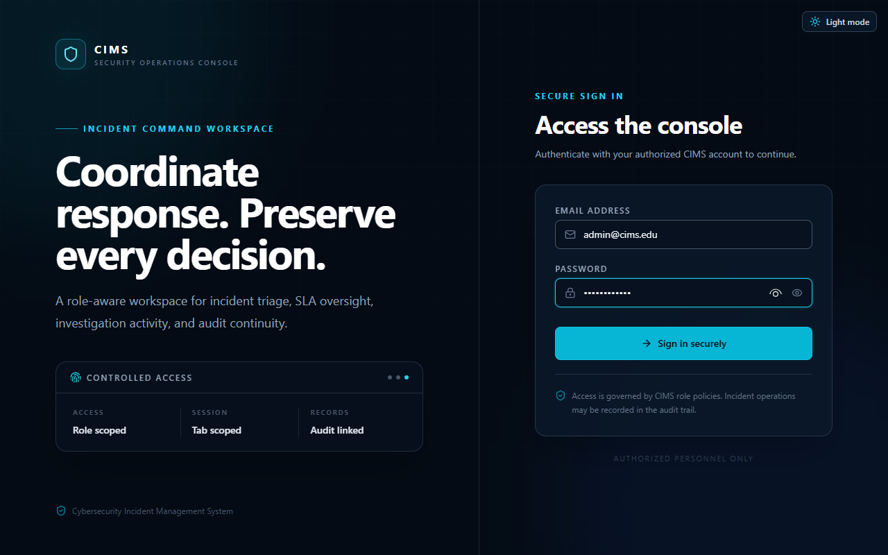
  
  

    <strong>Fig 1: Shows the Admin Login interface</strong>
  

  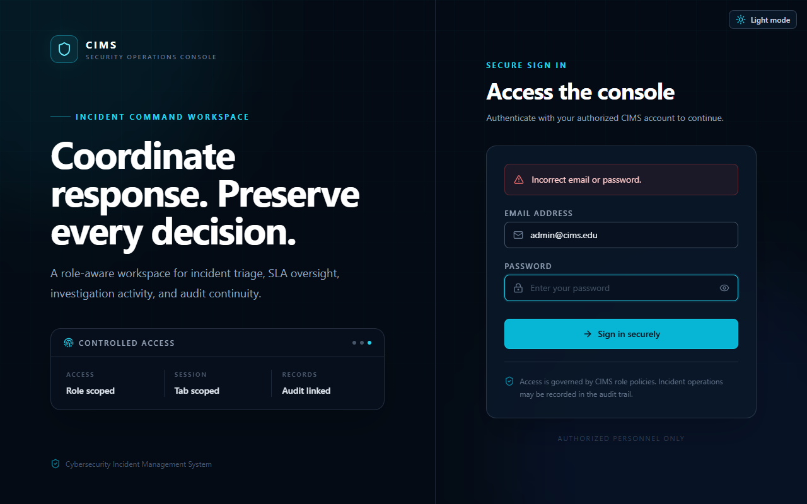
  
  

    <strong>Fig 2: Login interface displaying an error message for invalid credentials, ensuring secure authentication for invalid login attempts.</strong>
  

 

<strong>Department of AI&ML, RVCE</strong>

<!-- PAGE 2 -->

  <h2>Form, Validation and Security</h2>
  
   

  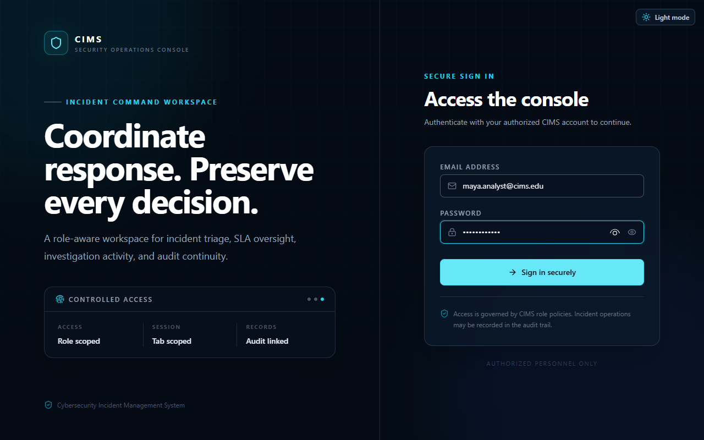
  
  

    <strong>Fig 3: User login interface for Analyst and Reporter accounts enabling role-based access control.</strong>
  

  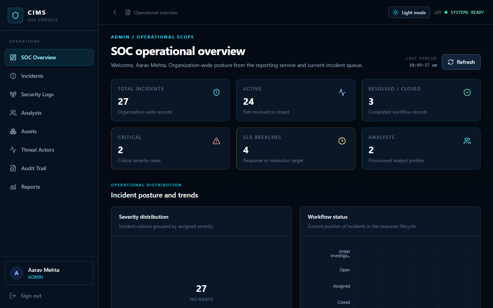
  
  

    <strong>Fig 4: Demonstrates how the application enforces role-based authorization, allowing only authorized SOC personnel to access specific operational metrics and database records.</strong>
  

 

<strong>Department of AI&ML, RVCE</strong>

<!-- PAGE 3 -->

  <h2>Form, Validation and Security</h2>
  
   

  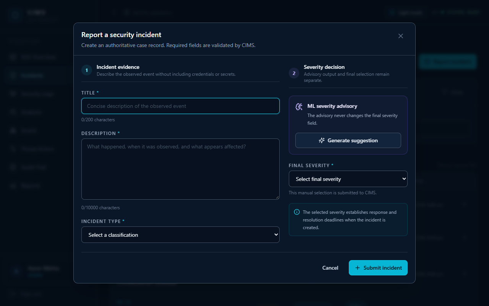
  
  

    <strong>Fig 5: Incident reporting form providing input fields for title, description, incident classification category, and severity rating.</strong>
  

  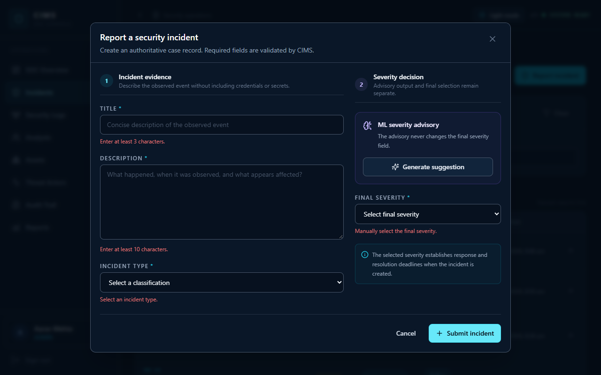
  
  

    <strong>Fig 6: Form validation displaying field-level error messages for required fields and character length constraints, preventing malformed inputs.</strong>
  

 

<strong>Department of AI&ML, RVCE</strong>

<!-- PAGE 4 -->

  <h2>Form, Validation and Security</h2>
  
   

  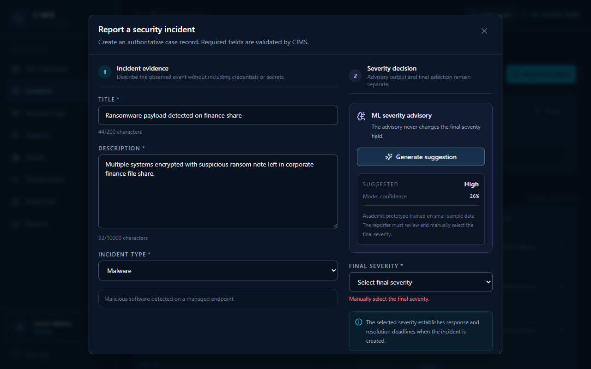
  
  

    <strong>Fig 7: Incident reporting form demonstrating automated AI-assisted severity classification based on natural language event description.</strong>
  

  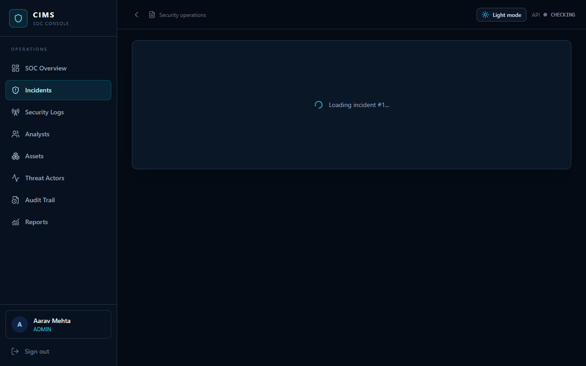
  
  

    <strong>Fig 8: Shows incident assignment to an analyst with workload update and lifecycle transition from 'Open' to 'Assigned'.</strong>
  

 

<strong>Department of AI&ML, RVCE</strong>

<!-- PAGE 5 -->

  <h2>Form, Validation and Security</h2>
  
   

  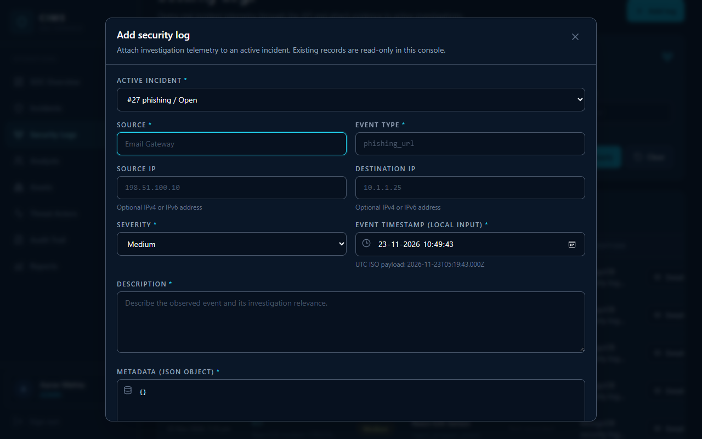
  
  

    <strong>Fig 9: Security log telemetry form (MongoDB integration) showing source, event type, source IP, destination IP, and JSON metadata.</strong>
  

  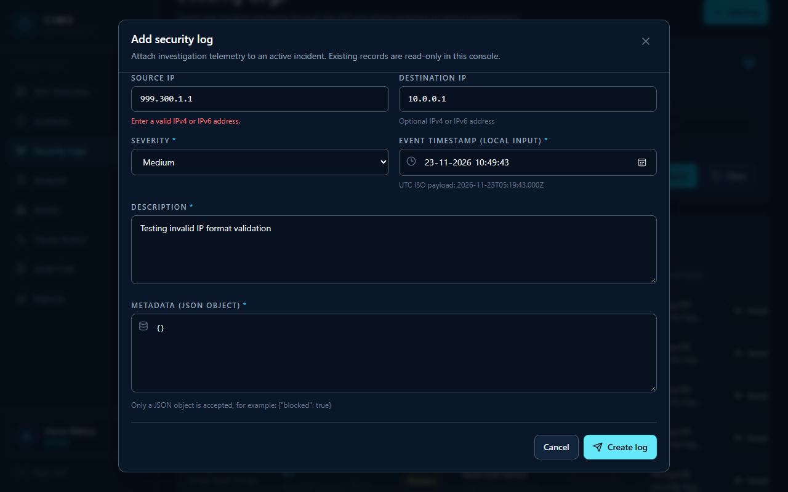
  
  

    <strong>Fig 10: Input validation error when an invalid IP address format is entered, ensuring network telemetry data integrity.</strong>
  

 

<strong>Department of AI&ML, RVCE</strong>

<!-- PAGE 6 -->

  <h2>Form, Validation and Security</h2>
  
   

  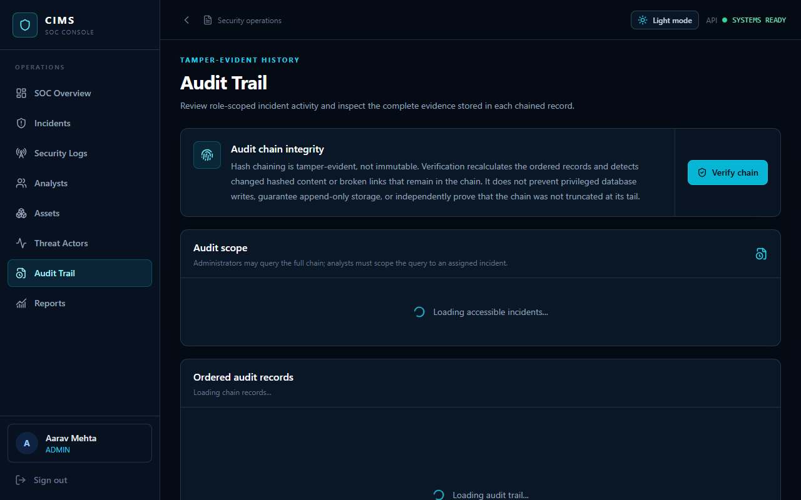
  
  

    <strong>Fig 11: Cryptographic SHA-256 audit ledger tracking state mutations, previous block hashes, and timestamps for non-repudiation.</strong>
  

  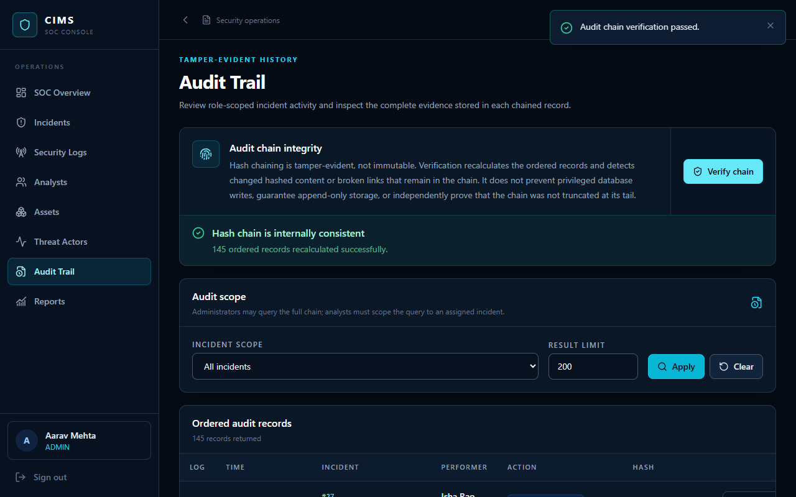
  
  

    <strong>Fig 12: Cryptographic audit chain verification interface displaying 100% mathematical integrity validation against database tampering.</strong>
  

 

<strong>Department of AI&ML, RVCE</strong>

